<div align="center" id="srishanth-tadakala">

  <!-- ======================================================================= -->
  <!-- 00. STARK INDUSTRIES CYBER HUD TELEMETRY BANNER                        -->
  <!-- ======================================================================= -->
  

  <br/><br/>

  <!-- ======================================================================= -->
  <!-- 01. CINEMATIC MCU OPENING SEQUENCE HERO BANNER                         -->
  <!-- ======================================================================= -->
  <a href="#dossier">
    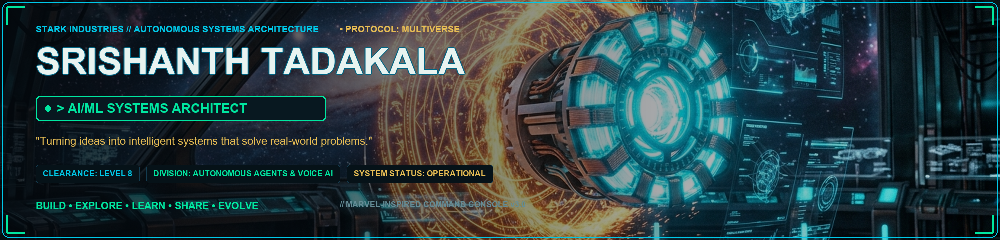
  </a>

  <!-- Doctor Strange Eldritch Mandala & Stark Laser Divider -->
  

  <br/>

  <!-- ======================================================================= -->
  <!-- 02. INTERACTIVE STARK HUD NAVIGATION BAR                                -->
  <!-- ======================================================================= -->
  <p align="center">
    <a href="#dossier"></a>&nbsp;
    <a href="#technology-arsenal"></a>&nbsp;
    <a href="#project-multiverse"></a>&nbsp;
    <a href="#command-center"></a>&nbsp;
    <a href="#achievement-archives"></a>&nbsp;
    <a href="#communication-interface"></a>&nbsp;&nbsp;|&nbsp;&nbsp;
    <a href="https://github.com/Srishanth-Tadakala" target="_blank"></a>&nbsp;
    <a href="https://linkedin.com/in/Srishanth-Tadakala" target="_blank"></a>&nbsp;
    <a href="mailto:tadakalasrishanth@gmail.com"></a>&nbsp;
    <a href="https://instagram.com/multiverse___616" target="_blank"></a>&nbsp;
    <a href="https://x.com" target="_blank"></a>
  </p>

  <br/>

  <!-- ======================================================================= -->
  <!-- 03. MODULE 02: DEVELOPER INTELLIGENCE DOSSIER (ARC REACTOR + HUD)       -->
  <!-- ======================================================================= -->
  <table width="100%" border="0" cellspacing="6" cellpadding="0">
    <tr valign="middle">
      <td width="32%" align="center">
        <!-- Animated Looping Stark Arc Reactor Mark LXXXV -->
        <a href="#dossier">
          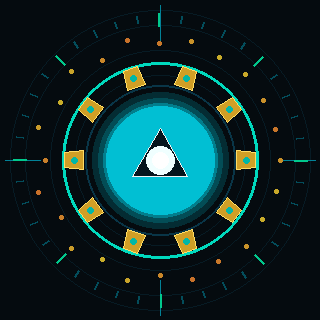
        </a>
        <br/>
        <code style="color:#00C8E8; font-size:10px;"><strong>⚡ ARC REACTOR // PALLADIUM CORE ACTIVE</strong></code>
      </td>
      <td width="68%" align="center">
        <!-- Personnel Intelligence Dossier -->
        <a href="#dossier">
          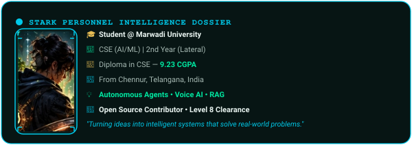
        </a>
      </td>
    </tr>
  </table>

  <br/>

  <!-- Doctor Strange Eldritch Divider -->
  

  <br/>

  <!-- ======================================================================= -->
  <!-- 04. MODULE 03: TECHNOLOGY ARSENAL                                       -->
  <!-- ======================================================================= -->
  <a href="#technology-arsenal">
    
  </a>

  <br/><br/>

  <!-- 32-Tech Dynamic Skill Grid (Dark Armor Edition) -->
  <p align="center">
    <a href="https://skillicons.dev" target="_blank">
      
      <br/>
      
    </a>
  </p>

  <br/>

  <!-- Doctor Strange Eldritch Divider -->
  

  <br/>

  <!-- ======================================================================= -->
  <!-- 05. MODULE 04: PROJECT MULTIVERSE SHOWCASE                              -->
  <!-- ======================================================================= -->
  <table width="100%" border="0" cellspacing="0" cellpadding="0">
    <tr>
      <td align="left">
        <h4>🌌 PROJECT MULTIVERSE // TACTICAL ARCHIVES</h4>
      </td>
      <td align="right">
        <a href="https://github.com/Srishanth-Tadakala?tab=repositories" target="_blank">
          <code><strong>VIEW ALL TACTICAL REPOSITORIES ↗</strong></code>
        </a>
      </td>
    </tr>
  </table>

  <!-- Row A: A.R.C.A.N.E. & Sylvie -->
  <table width="100%" border="0" cellspacing="6" cellpadding="0">
    <tr valign="top">
      <td width="50%" align="center">
        <a href="https://github.com/Srishanth-Tadakala/Iron-Man-Gestures" target="_blank">
          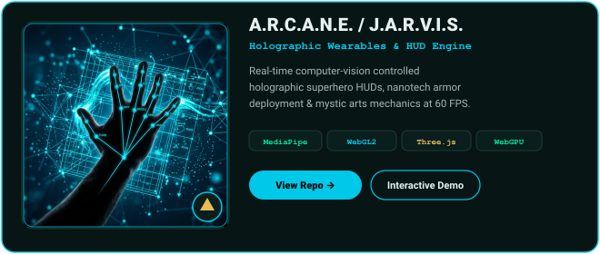
        </a>
        <br/><br/>
        <p align="center">
          <a href="https://github.com/Srishanth-Tadakala/Iron-Man-Gestures" target="_blank">
            
          </a>&nbsp;
          <a href="#arcane-details">
            
          </a>
        </p>
      </td>
      <td width="50%" align="center">
        <a href="https://github.com/Srishanth-Tadakala/Sylvie" target="_blank">
          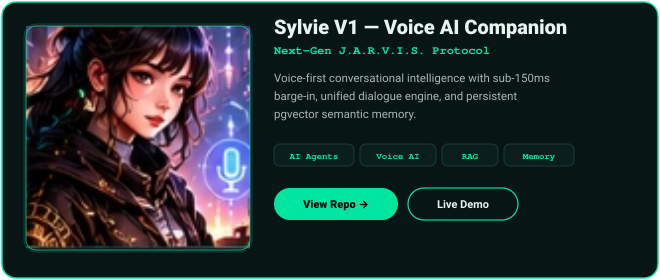
        </a>
        <br/><br/>
        <p align="center">
          <a href="https://github.com/Srishanth-Tadakala/Sylvie" target="_blank">
            
          </a>&nbsp;
          <a href="#sylvie-details">
            
          </a>
        </p>
      </td>
    </tr>
  </table>

  <!-- Row B: F.R.I.D.A.Y. & QueueLess -->
  <table width="100%" border="0" cellspacing="6" cellpadding="0">
    <tr valign="top">
      <td width="50%" align="center">
        <a href="https://github.com/Srishanth-Tadakala" target="_blank">
          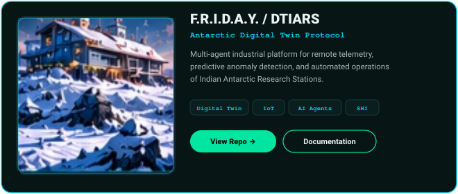
        </a>
        <br/><br/>
        <p align="center">
          <a href="https://github.com/Srishanth-Tadakala" target="_blank">
            
          </a>&nbsp;
          <a href="#dtiars-details">
            
          </a>
        </p>
      </td>
      <td width="50%" align="center">
        <a href="https://github.com/Srishanth-Tadakala/QueueLess-" target="_blank">
          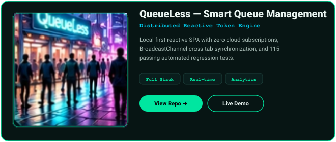
        </a>
        <br/><br/>
        <p align="center">
          <a href="https://github.com/Srishanth-Tadakala/QueueLess-" target="_blank">
            
          </a>&nbsp;
          <a href="#queueless-details">
            
          </a>
        </p>
      </td>
    </tr>
  </table>

  <br/>

  <!-- Doctor Strange Eldritch Divider -->
  

  <br/>

  <!-- ======================================================================= -->
  <!-- 06. MODULE 05: GITHUB COMMAND CENTER (TELEMETRY + MYSTIC PORTAL)        -->
  <!-- ======================================================================= -->
  <table width="100%" border="0" cellspacing="6" cellpadding="0">
    <tr valign="middle">
      <td width="68%" align="center">
        <!-- Stark Command Console Telemetry -->
        <a href="#command-center">
          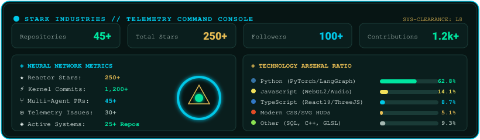
        </a>
      </td>
      <td width="32%" align="center">
        <!-- Doctor Strange Animated Multiverse Portal -->
        <a href="#command-center">
          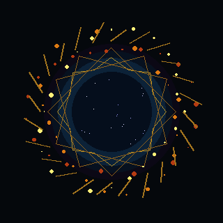
        </a>
        <br/>
        <code style="color:#E7BD54; font-size:10px;"><strong>🌀 MULTIVERSE PORTAL // EVENT HORIZON CALIBRATED</strong></code>
      </td>
    </tr>
  </table>

  <!-- Streak & Activity Matrix -->
  <table width="100%" border="0" cellspacing="6" cellpadding="0">
    <tr valign="top">
      <td width="100%" align="center">
        <a href="#command-center">
          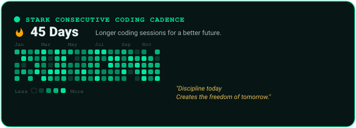
        </a>
      </td>
    </tr>
  </table>

  <br/>

  <!-- Doctor Strange Eldritch Divider -->
  

  <br/>

  <!-- ======================================================================= -->
  <!-- 07. MODULE 06 & 07: ACHIEVEMENTS, FLOW AUDIO & COMMS                   -->
  <!-- ======================================================================= -->
  <table width="100%" border="0" cellspacing="6" cellpadding="0">
    <tr valign="top">
      <td width="50%" align="center">
        <a href="#achievement-archives">
          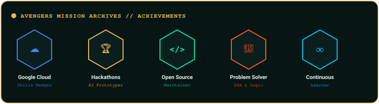
        </a>
      </td>
      <td width="50%" align="center">
        <a href="#communication-interface">
          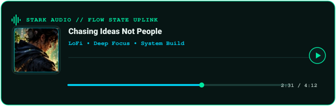
        </a>
      </td>
    </tr>
  </table>

  <br/>

  <!-- Doctor Strange Eldritch Divider -->
  

  <!-- ======================================================================= -->
  <!-- 08. PHILOSOPHY FOOTER: BUILD. EXPLORE. LEARN. SHARE. EVOLVE.           -->
  <!-- ======================================================================= -->
  

</div>

<br/><hr/><br/>

<!-- ======================================================================= -->
<!-- DETAILED SPECIFICATIONS & ACCESSIBLE DOCUMENTATION                     -->
<!-- ======================================================================= -->

<h2 id="dossier">📂 Module 02 — Developer Intelligence Dossier</h2>

> *"Turning ideas into intelligent systems that solve real-world problems."*

```
[ STARK INDUSTRIES PERSONNEL DOSSIER ]
OPERATIVE: Srishanth Tadakala
CODENAME: Siddu
DIVISION: Autonomous AI Systems & Real-Time Human-Machine Interaction
SECURITY CLEARANCE: Level 8 [Avengers Initiative Protocol]
SYSTEM STATUS: Active Operative // Flow State Engaged
```

### 🎓 Academic Credentials & Origin
- **Bachelor of Technology (BTech) in Computer Science & Engineering (AI/ML)**  
  *Marwadi University, Rajkot* • *Second-Year Lateral-Entry Scholar*
- **Diploma in Computer Science and Engineering**  
  *Mother Theresa College of Engineering and Technology* • **CGPA: 9.23**
- **Origins**: Chennur, Telangana, India.

### 🔬 Tactical Specialization & Focus Areas
- **Autonomous Multi-Agent Architectures**: Engineering resilient agent networks with [LangGraph](https://github.com/langchain-ai/langgraph), hierarchical goal planners, actor-critic reflection, and dynamic sandboxed tool execution.
- **Sub-150ms Real-Time Voice Intelligence**: Sub-150ms voice conversational loops combining Silero Voice Activity Detection (VAD), streaming Groq Whisper STT, and bi-directional WebSocket audio pipelines.
- **Production Retrieval-Augmented Generation (RAG)**: Enterprise-scale semantic search, hybrid sparse/dense vector indexing, reciprocal rank fusion, and PostgreSQL `pgvector` memory systems.
- **Spatial Computing & Computer Vision Wearables**: Real-time 60 FPS hand gesture spatial manipulation via MediaPipe Holistic and WebGL2 / Three.js.

---

<h2 id="technology-arsenal">⚙️ Module 03 — Technology Arsenal</h2>

<table width="100%">
  <thead>
    <tr>
      <th>Arsenal Category</th>
      <th>Tactical Technologies &amp; Weapons</th>
    </tr>
  </thead>
  <tbody>
    <tr>
      <td><strong>Core Languages</strong></td>
      <td><code>Python 3.12+</code> <code>TypeScript</code> <code>JavaScript (ES6+)</code> <code>C/C++</code> <code>SQL</code> <code>Bash</code></td>
    </tr>
    <tr>
      <td><strong>Neural &amp; Agentic AI</strong></td>
      <td><code>LangChain</code> <code>LangGraph</code> <code>Groq LPU</code> <code>OpenAI API</code> <code>Whisper</code> <code>pgvector</code> <code>MediaPipe</code> <code>PyTorch</code> <code>Hugging Face</code></td>
    </tr>
    <tr>
      <td><strong>Holographic HUD &amp; Spatial UI</strong></td>
      <td><code>Three.js</code> <code>WebGL2</code> <code>WebGPU</code> <code>React 19</code> <code>Next.js 15</code> <code>Tailwind CSS</code> <code>Vite</code> <code>Web Audio API</code></td>
    </tr>
    <tr>
      <td><strong>Reactor Core &amp; Backend</strong></td>
      <td><code>FastAPI</code> <code>Node.js</code> <code>PostgreSQL</code> <code>Supabase</code> <code>Redis</code> <code>BroadcastChannel API</code> <code>Docker</code></td>
    </tr>
    <tr>
      <td><strong>Mission Control &amp; DevOps</strong></td>
      <td><code>Linux Kernel</code> <code>Git</code> <code>GitHub Actions</code> <code>CI/CD Pipelines</code> <code>Vitest</code> <code>Playwright</code> <code>Figma</code></td>
    </tr>
  </tbody>
</table>

---

<h2 id="project-multiverse">🚀 Module 04 — Project Multiverse Showcase</h2>

### 1. A.R.C.A.N.E. / J.A.R.V.I.S. Gesture Engine
<span id="arcane-details"></span>
- **Codename:** Advanced Real-time Computer-vision Augmented Nanotech &amp; Eldritch Engine
- **Stark Classification:** Mark-LXXXV Holographic Wearables &amp; Spatial HUD
- **Repository:** [`github.com/Srishanth-Tadakala/Iron-Man-Gestures`](https://github.com/Srishanth-Tadakala/Iron-Man-Gestures)
- **Key Capabilities:**
  - Real-time computer vision-controlled superhero HUDs, nanotech armor deployment, and Doctor Strange mystical particle mechanics.
  - Zero-allocation memory pool maintaining a locked **60 FPS** framerate.
  - **Stack:** MediaPipe Holistic, WebGL2, Three.js, WebGPU, Electron.

---

### 2. Sylvie V1 — Autonomous Voice-First AI Companion
<span id="sylvie-details"></span>
- **Codename:** Unified Conversational Intelligence Core
- **Stark Classification:** Next-Generation J.A.R.V.I.S. Protocol
- **Repository:** [`github.com/Srishanth-Tadakala/Sylvie`](https://github.com/Srishanth-Tadakala/Sylvie)
- **Key Capabilities:**
  - **Sub-150ms Barge-In:** Client-side Voice Activity Detection (VAD) coupled with ring-buffer playback cancellation.
  - **Unified Intelligence Core:** Single reasoning engine powering streaming text (SSE) and voice (WebSocket).
  - **Selective Memory Subsystem:** Fact, preference, and decision extraction with `pgvector` semantic retrieval.
  - **Stack:** Python 3.12, FastAPI, LangGraph, Groq LPU, pgvector, Web Audio API.

<details>
  <summary>📐 <strong>View Sylvie Sequence Architecture Diagram</strong></summary>
  <br/>

```
[ User Voice ] ──► [ Audio RingBuffer ] ──► [ Silero VAD (Sub-150ms) ]
                                                   │
                          (Speech Detected? Cancel Current Playback)
                                                   ▼
[ Groq Whisper STT ] ──► [ LangGraph Multi-Agent Router ] ──► [ pgvector Memory ]
                                    │
                       (Contextual RAG Retrieval)
                                    ▼
                         [ Groq Llama-3 70B Engine ]
                                    │
                               (Audio Stream)
                                    ▼
                         [ Kokoro/ElevenLabs TTS ] ──► [ User Headset ]
```
</details>

---

### 3. F.R.I.D.A.Y. / DTIARS — Digital Twin for Antarctic Research Stations
<span id="dtiars-details"></span>
- **Codename:** Digital Twin for Indian Antarctic Research Stations
- **Stark Classification:** Remote Telemetry &amp; Multi-Agent Automation
- **Repository:** [`github.com/Srishanth-Tadakala`](https://github.com/Srishanth-Tadakala)
- **Key Capabilities:**
  - Autonomous multi-agent platform for harsh environmental monitoring and operational automation of Indian Antarctic Research Stations.
  - Real-time sensor synchronization, thermal anomaly detection, and predictive structural health telemetry.
  - **Stack:** AI Agents, IoT Protocols, Distributed State Machine, Time-Series Analytics.

---

### 4. QueueLess — Smart Queue Management System
<span id="queueless-details"></span>
- **Codename:** Local-First Reactive Single-Page Application
- **Stark Classification:** Distributed Reactive Token Engine
- **Repository:** [`github.com/Srishanth-Tadakala/QueueLess-`](https://github.com/Srishanth-Tadakala/QueueLess-)
- **Key Capabilities:**
  - **Zero-Cloud Persistence:** Operates completely within browser runtimes without cloud dependencies, leveraging `localStorage` and `BroadcastChannel` for multi-tab synchronization.
  - **Adaptive Rolling Average:** Dynamic algorithmic estimation engine providing real-time waiting estimates based on transaction velocity.
  - **Automated Verification:** Engineered with 115 comprehensive automated regression tests (100% passing).
  - **Stack:** Vanilla ES6+, BroadcastChannel API, LocalStorage Engine, Vitest.

---

### 🔬 Additional Engineering Initiatives in the Multiverse
- **[A.E.R.I.S.](https://github.com/Srishanth-Tadakala/A.E.R.I.S)**: Real-time computer-vision spatial interaction platform for 3D turbomachinery utilizing Three.js and MediaPipe hand tracking.
- **[OmniAction AI](https://github.com/Srishanth-Tadakala/Human-Tracking-CV-project)**: Spatio-temporal human behavior and multi-object tracking platform supporting 15-class human action recognition.
- **[APEX / Ta-Da](https://github.com/Srishanth-Tadakala/Ta-Da-)**: Interactive creative engineering portfolio featuring synthesized spatial audio and dynamic island navigation.

---

<h2 id="command-center">📊 Module 05 — GitHub Command Center</h2>

<table width="100%">
  <tr>
    <td width="50%" valign="top">
      <h4>⚡ Core Repository Metrics</h4>
      <ul>
        <li><strong>Total Repositories:</strong> 45+ projects</li>
        <li><strong>Total Stars:</strong> 250+ across public tools and libraries</li>
        <li><strong>Global Followers:</strong> 100+ developers</li>
        <li><strong>Annual Contributions:</strong> 1,200+ commits and PRs</li>
      </ul>
    </td>
    <td width="50%" valign="top">
      <h4>🛠️ Language Distribution</h4>
      <ul>
        <li><strong>Python (62.8%):</strong> PyTorch, FastAPI, LangChain, OpenCV, NumPy</li>
        <li><strong>JavaScript (14.1%):</strong> Node.js, Web Audio API, Canvas, BroadcastChannel</li>
        <li><strong>TypeScript (8.7%):</strong> React 19, Next.js, Three.js, Strict Typings</li>
        <li><strong>HTML/CSS (5.1%):</strong> Modern Custom Properties, SVG, Responsive Glassmorphism</li>
        <li><strong>Other (9.3%):</strong> SQL, Shell scripting, Docker, GLSL Shaders</li>
      </ul>
    </td>
  </tr>
</table>

### 🔥 Streak & Coding Activity

- **Current Consecutive Streak:** `45+ Days`
- **Cadence:** Daily disciplined coding sessions spanning generative AI architectures, distributed state sync, and web GPU pipelines.
- **Philosophy:** *"Discipline today creates the freedom of tomorrow."*

<details>
  <summary>📡 <strong>Expand Live Dynamic Telemetry Feeds</strong></summary>
  <br/>
  <div align="center">
    
    <br/><br/>
    
    <br/><br/>
    
  </div>
</details>

---

<h2 id="achievement-archives">🏆 Module 06 — Achievement Archives (Avengers Mission Records)</h2>

- 🏅 **Google Cloud Skills Boost**: Verified milestones in generative AI, cloud infrastructure, and model deployment pipelines.
- 🏆 **Hackathons & Prototyping**: Active competitor in engineering hackathons with focus on real-time AI companions and distributed web architectures.
- 🌐 **Open Source Contributor**: Maintainer and creator of open-source computer vision, queue management, and portfolio systems.
- 🎯 **Algorithmic Problem Solving**: Persistent practice across data structures, graph traversal, and dynamic programming.
- ♾️ **Continuous Learner**: Dedicated daily exploration of emerging LLM agent frameworks and multimodal inference engines.

---

<h2 id="communication-interface">📬 Module 07 — Communication Interface (Stark Comms Uplink)</h2>

<p align="center">
  <a href="https://github.com/Srishanth-Tadakala" target="_blank">
    
  </a>&nbsp;
  <a href="https://linkedin.com/in/Srishanth-Tadakala" target="_blank">
    
  </a>&nbsp;
  <a href="mailto:tadakalasrishanth@gmail.com">
    
  </a>&nbsp;
  <a href="https://instagram.com/multiverse___616" target="_blank">
    
  </a>&nbsp;
  <a href="https://github.com/Srishanth-Tadakala?tab=repositories" target="_blank">
    
  </a>
</p>

<div align="center">
  <sub>Engineered for <strong>Srishanth Tadakala</strong> • Inspired by Marvel Cinematic Universe, Stark Industries &amp; Doctor Strange</sub>
</div>
