

  <!-- ========================================== -->
  <!-- 01. CINEMATIC HERO BANNER                  -->
  <!-- ========================================== -->
  <a href="#about-me">
    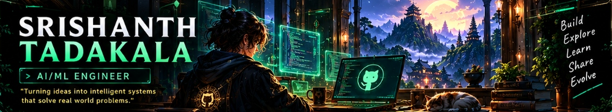
  </a>

    

  <!-- ========================================== -->
  <!-- 02. INTERACTIVE NAVIGATION BAR             -->
  <!-- ========================================== -->
  

    &nbsp;
    &nbsp;
    &nbsp;
    &nbsp;
    &nbsp;
    &nbsp;
    &nbsp;&nbsp;|&nbsp;&nbsp;
    &nbsp;
    &nbsp;
    &nbsp;
    &nbsp;
    
  

   

  <!-- ========================================== -->
  <!-- 03 & 04. ROW 1: ABOUT ME | STATS | STREAK  -->
  <!-- ========================================== -->
  <table width="100%" border="0" cellspacing="6" cellpadding="0">
    <tr valign="top">
      <td width="30%" align="center">
        <a href="#about-me">
          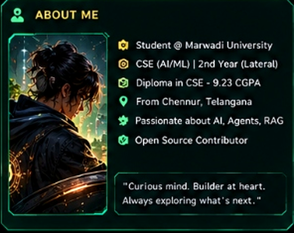
        </a>
      </td>
      <td width="42%" align="center">
        <a href="#github-stats">
          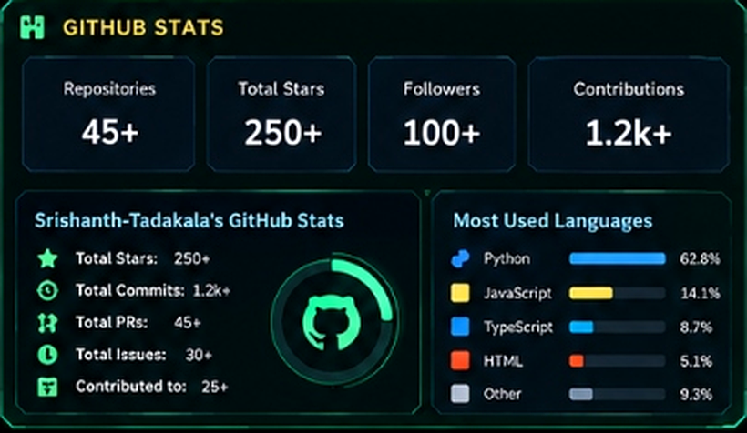
        </a>
      </td>
      <td width="28%" align="center">
        <a href="#streak-and-activity">
          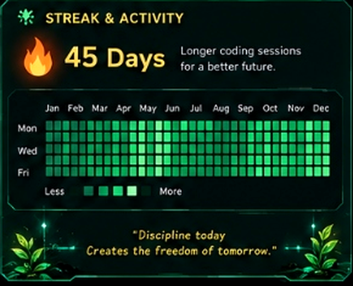
        </a>
      </td>
    </tr>
  </table>

   

  <!-- ========================================== -->
  <!-- 05. ROW 2: TECH STACK SHOWCASE             -->
  <!-- ========================================== -->
  <a href="#tech-stack">
    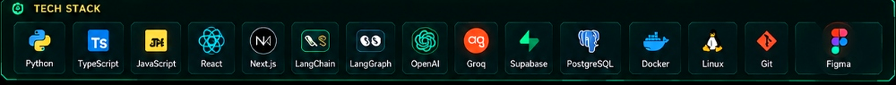
  </a>

    

  <!-- ========================================== -->
  <!-- 06. ROW 3: FEATURED PROJECTS               -->
  <!-- ========================================== -->
  <table width="100%" border="0" cellspacing="0" cellpadding="0">
    <tr>
      <td align="left">
        <h4>🚀 FEATURED PROJECTS</h4>
      </td>
      <td align="right">
        <a href="https://github.com/Srishanth-Tadakala?tab=repositories" target="_blank">
          <code><strong>VIEW ALL REPOSITORIES ↗</strong></code>
        </a>
      </td>
    </tr>
  </table>

  <table width="100%" border="0" cellspacing="6" cellpadding="0">
    <tr valign="top">
      <td width="33.3%" align="center">
        <a href="https://github.com/Srishanth-Tadakala/Sylvie" target="_blank">
          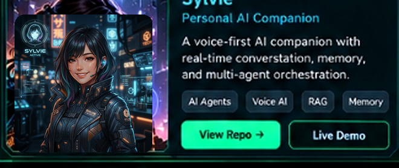
        </a>
          
        

          &nbsp;
          
        

      </td>
      <td width="33.3%" align="center">
        <a href="https://github.com/Srishanth-Tadakala" target="_blank">
          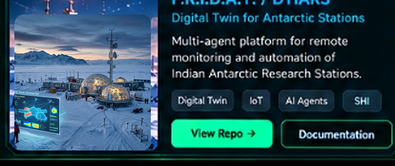
        </a>
          
        

          &nbsp;
          
        

      </td>
      <td width="33.3%" align="center">
        <a href="https://github.com/Srishanth-Tadakala/QueueLess-" target="_blank">
          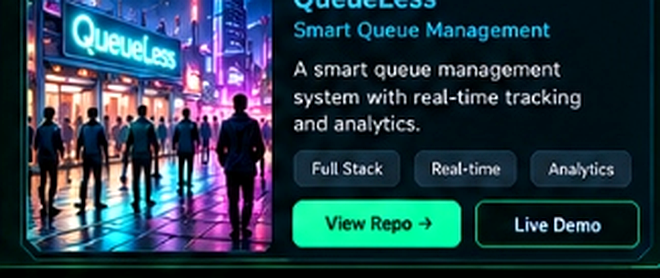
        </a>
          
        

          &nbsp;
          
        

      </td>
    </tr>
  </table>

   

  <!-- ========================================== -->
  <!-- 07, 08, 09. ROW 4: ACHIEVEMENTS | LEARNING | NOW PLAYING -->
  <!-- ========================================== -->
  <table width="100%" border="0" cellspacing="6" cellpadding="0">
    <tr valign="top">
      <td width="38%" align="center">
        <a href="#achievements">
          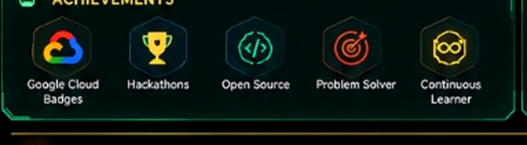
        </a>
      </td>
      <td width="28%" align="center">
        <a href="#currently-learning">
          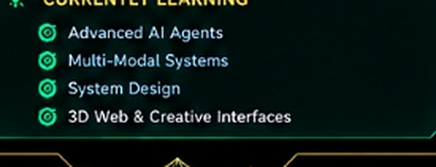
        </a>
      </td>
      <td width="34%" align="center">
        <a href="#now-playing">
          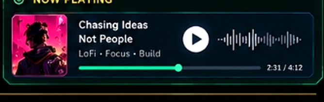
        </a>
      </td>
    </tr>
  </table>

   

  <!-- ========================================== -->
  <!-- 10. ROW 5: FOOTER DIVIDER & PHILOSOPHY     -->
  <!-- ========================================== -->
  

 
 

<!-- ======================================================================= -->
<!-- DETAILED SPECIFICATIONS & ACCESSIBLE DOCUMENTATION                     -->
<!-- ======================================================================= -->

<h2 id="about-me">👤 About Me</h2>

> *"Turning ideas into intelligent systems that solve real-world problems."*

I am an **AI/ML Engineer**, **Computer Science Student**, and **Open Source Contributor** focused on the intersection of autonomous agents, conversational intelligence, and high-performance interactive architectures. My work emphasizes practical systems engineering: transforming cutting-edge machine learning research into responsive, resilient software.

### 🎓 Academic Background & Credentials
- **Bachelor of Technology (BTech) in Computer Science & Engineering (AI/ML)**  
  *Marwadi University, Rajkot* • *Second-Year Lateral-Entry Scholar*
- **Diploma in Computer Science and Engineering**  
  *Mother Theresa College of Engineering and Technology* • **CGPA: 9.23**
- **Origins**: Chennur, Telangana, India.

### 🔭 Core Technical Focus
- **Agentic AI & Multi-Agent Orchestration**: Designing stateful agent graphs with [LangGraph](https://github.com/langchain-ai/langgraph), hierarchical goal planners, and dynamic tool retrieval.
- **Real-Time Voice AI**: Engineering sub-150ms latency conversational loops combining client-side Voice Activity Detection (VAD), streaming speech-to-text, and WebSocket audio pipelines.
- **Retrieval-Augmented Generation (RAG)**: Production vector indexing, hybrid dense/sparse search, reranking strategies, and `pgvector` semantic retrieval.
- **Spatial Computing & Interactive Interfaces**: High-framerate WebGL/Three.js spatial visualizations driven by real-time computer vision models.

---

<h2 id="github-stats">📊 Telemetry & GitHub Statistics</h2>

<table width="100%">
  <tr>
    <td width="50%" valign="top">
      <h4>⚡ Core Repository Metrics</h4>
      <ul>
        <li><strong>Total Repositories:</strong> 45+ projects</li>
        <li><strong>Total Stars:</strong> 250+ across public tools and libraries</li>
        <li><strong>Global Followers:</strong> 100+ developers</li>
        <li><strong>Annual Contributions:</strong> 1,200+ commits and PRs</li>
      </ul>
    </td>
    <td width="50%" valign="top">
      <h4>🛠️ Language Distribution</h4>
      <ul>
        <li><strong>Python (62.8%):</strong> PyTorch, FastAPI, LangChain, OpenCV, NumPy</li>
        <li><strong>JavaScript (14.1%):</strong> Node.js, Web Audio API, Canvas, BroadcastChannel</li>
        <li><strong>TypeScript (8.7%):</strong> React 19, Next.js, Three.js, Strict Typings</li>
        <li><strong>HTML/CSS (5.1%):</strong> Modern Custom Properties, SVG, Responsive Glassmorphism</li>
        <li><strong>Other (9.3%):</strong> SQL, Shell scripting, Docker, GLSL Shaders</li>
      </ul>
    </td>
  </tr>
</table>

<h3 id="streak-and-activity">🔥 Streak & Coding Activity</h3>

- **Current Consecutive Streak:** `45+ Days`
- **Cadence:** Daily disciplined coding sessions spanning generative AI architectures, distributed state sync, and web GPU pipelines.
- **Philosophy:** *"Discipline today creates the freedom of tomorrow."*

  
📡 <strong>Expand Live Dynamic Telemetry Feeds</strong>

   
  

    
      
    
  

---

<h2 id="tech-stack">⚙️ Technology Stack & Toolchain</h2>

| Category | Technologies & Frameworks |
| :--- | :--- |
| **Languages** | `Python` `TypeScript` `JavaScript` `SQL` `Bash` |
| **Artificial Intelligence** | `LangChain` `LangGraph` `OpenAI API` `Groq API` `RAG (pgvector)` `Whisper` `MediaPipe` |
| **Frontend Engineering** | `React 19` `Next.js` `Three.js` `Vite` `Tailwind CSS` `WebGL2` |
| **Backend & Cloud** | `FastAPI` `Node.js` `PostgreSQL` `Supabase` `Docker` `Linux` |
| **DevOps & Design** | `Git` `GitHub Actions` `CI/CD Pipelines` `Figma` |

---

<h2 id="featured-projects">🚀 Featured Projects Architecture</h2>

### 1. Sylvie — Personal AI Companion

- **Category:** Persistent Voice-First AI Companion & Conversational Intelligence
- **Repository:** [`github.com/Srishanth-Tadakala/Sylvie`](https://github.com/Srishanth-Tadakala/Sylvie)
- **Key Capabilities:**
  - **Single Intelligence Core:** Unified dialogue engine orchestrating streaming text over Server-Sent Events (SSE) and bi-directional real-time audio over WebSockets.
  - **Sub-150ms Barge-In:** Client-side Voice Activity Detection (VAD) coupled with ring-buffer audio playback cancellation.
  - **Selective Memory Subsystem:** Fact, preference, and decision extraction stored in PostgreSQL with `pgvector` semantic retrieval.
  - **Architecture Stack:** Python 3.12, FastAPI, LangGraph, Groq LPU, pgvector, Web Audio API.

---

### 2. F.R.I.D.A.Y. / DTIARS — Digital Twin for Antarctic Research Stations

- **Category:** Remote Telemetry & Multi-Agent Industrial Digital Twin
- **Repository:** [`github.com/Srishanth-Tadakala`](https://github.com/Srishanth-Tadakala)
- **Key Capabilities:**
  - **Autonomous Station Telemetry:** Comprehensive multi-agent platform designed for harsh environmental monitoring and operational automation of Indian Antarctic Research Stations.
  - **Digital Twin Simulation:** Real-time sensor synchronization, thermal anomaly detection, and predictive structural health telemetry.
  - **Architecture Stack:** AI Agents, IoT Protocols, Distributed State Machine, Time-Series Analytics.

---

### 3. QueueLess — Smart Queue Management System

- **Category:** Local-First Reactive Single-Page Application (SPA)
- **Repository:** [`github.com/Srishanth-Tadakala/QueueLess-`](https://github.com/Srishanth-Tadakala/QueueLess-)
- **Key Capabilities:**
  - **Zero-Cloud Persistence:** Operates completely within browser runtimes without cloud dependencies, leveraging `localStorage` and `BroadcastChannel` for multi-tab synchronization.
  - **Adaptive Rolling Average:** Dynamic algorithmic estimation engine providing real-time waiting estimates based on transaction velocity.
  - **Automated Verification:** Engineered with 115 comprehensive automated regression tests (100% passing).
  - **Architecture Stack:** Vanilla ES6+, BroadcastChannel API, LocalStorage Engine, Vitest.

---

### 🔬 Additional Engineering Initiatives
- **[A.E.R.I.S.](https://github.com/Srishanth-Tadakala/A.E.R.I.S)**: Real-time computer-vision spatial interaction platform for 3D turbomachinery utilizing Three.js and MediaPipe hand tracking.
- **[OmniAction AI](https://github.com/Srishanth-Tadakala/Human-Tracking-CV-project)**: Spatio-temporal human behavior and multi-object tracking platform supporting 15-class human action recognition.
- **[Iron-Man Gestures](https://github.com/Srishanth-Tadakala/Iron-Man-Gestures)**: Real-time WebGL2/Three.js holographic wearables and HUD particle engine.

---

<h2 id="achievements">🏆 Milestones & Achievements</h2>

- 🏅 **Google Cloud Skills Boost**: Verified milestones in generative AI, cloud infrastructure, and model deployment pipelines.
- 🏆 **Hackathons & Prototyping**: Active competitor in engineering hackathons with focus on real-time AI companions and distributed web architectures.
- 🌐 **Open Source Contributor**: Maintainer and creator of open-source computer vision, queue management, and portfolio systems.
- 🎯 **Algorithmic Problem Solving**: Persistent practice across data structures, graph traversal, and dynamic programming.
- ♾️ **Continuous Learner**: Dedicated daily exploration of emerging LLM agent frameworks and multimodal inference engines.

---

<h2 id="currently-learning">🌱 Currently Learning & Research</h2>

- 🎯 **Advanced AI Agents**: Hierarchical multi-agent reflection loops, actor-critic planning, and tool sandboxing.
- 🎯 **Multi-Modal Systems**: Vision-language models (VLMs) and low-latency audio-to-audio neural architectures.
- 🎯 **System Design & Distributed State**: Event-driven architectures, local-first CRDT synchronization, and high-throughput microservices.
- 🎯 **3D Web & Creative Interfaces**: WebGPU, custom GLSL shaders, and procedural spatial audio integration.

---

<h2 id="now-playing">🎧 Audio & Flow State</h2>

- **Current Track:** *Chasing Ideas Not People*
- **Aesthetic:** LoFi • Deep Focus • System Architecture
- **Timeline Position:** `2:31 / 4:12`
- **Audio Philosophy:** Deep uninterrupted focus blocks fueling late-night engineering breakthroughs.

---

<h2 id="contact">📬 Transmission & Contact</h2>

  &nbsp;
  &nbsp;
  &nbsp;
  

  Designed &amp; Engineered with precision for <strong>Srishanth Tadakala</strong> • Inspired by Futuristic Command Consoles

