<!--  Generated by scripts/build_profile.py from data/profile.json + data/telemetry.json.
      Edit the data files (not this file) and run:  python scripts/build_profile.py  -->

<picture>
  <source media="(max-width: 600px)" srcset="assets/hero/hero-mobile.svg">
  
</picture>

  

&nbsp;
&nbsp;
&nbsp;
&nbsp;
&nbsp;

 

<picture>
  <source media="(max-width: 600px)" srcset="assets/headers/dossier-mobile.svg">
  
</picture>

&nbsp;

 

<picture>
  <source media="(max-width: 600px)" srcset="assets/headers/arsenal-mobile.svg">
  
</picture>

&nbsp;

 

<picture>
  <source media="(max-width: 600px)" srcset="assets/headers/multiverse-mobile.svg">
  
</picture>

<a href="https://github.com/Srishanth-Tadakala/DTIARS-x-FRIDAY-Automation"></a>&nbsp;

<a href="https://github.com/Srishanth-Tadakala/AI-Sales-Quotation-Automation"></a>&nbsp;
<a href="https://github.com/Srishanth-Tadakala/A.E.R.I.S"></a>

<a href="https://github.com/Srishanth-Tadakala/Human-Tracking-CV-project"></a>&nbsp;
<a href="https://github.com/Srishanth-Tadakala/QueueLess-"></a>

&nbsp;
&nbsp;
&nbsp;
&nbsp;
&nbsp;

&nbsp;
&nbsp;

 

<picture>
  <source media="(max-width: 600px)" srcset="assets/headers/command-mobile.svg">
  
</picture>

<picture>
  <source media="(max-width: 600px)" srcset="assets/command/radar-mobile.svg">
  
</picture>

&nbsp;

&nbsp;

 

<picture>
  <source media="(max-width: 600px)" srcset="assets/headers/archive-mobile.svg">
  
</picture>

<picture>
  <source media="(max-width: 600px)" srcset="assets/archive/records-mobile.svg">
  
</picture>

 

<picture>
  <source media="(max-width: 600px)" srcset="assets/headers/uplink-mobile.svg">
  
</picture>

&nbsp;
&nbsp;

&nbsp;

 

<picture>
  <source media="(max-width: 600px)" srcset="assets/finale/finale-mobile.svg">
  
</picture>

  

Plain-text dossier (accessible version)

**Srishanth Tadakala** — AI/ML Engineer · Computer Science Student · Open Source Contributor  
*“Turning ideas into intelligent systems that solve real-world problems.”*

**Education**

- B.Tech CSE (AI/ML) — Marwadi University, Rajkot (2nd year · lateral entry)
- Diploma in CSE — Mother Theresa College of Engg. & Tech. (CGPA 9.23)

- Origin: Chennur, Telangana

**Current mission:** Building Sylvie — a local AI companion with contextual reasoning, intelligent memory and long-term behavioural evolution

**Interests:** AI Agents, Multi-Agent Systems, LLM Engineering, RAG, Real-Time Voice AI, AI Memory Architectures, Computer Vision, System Architecture  
**Learning:** Advanced AI Agents, Multi-Modal Systems, System Design, 3D Web & Creative Interfaces

**Projects**

- **F.R.I.D.A.Y.** — Autonomous digital twin & cognitive operations platform for India's Antarctic research stations. [Repository](https://github.com/Srishanth-Tadakala/DTIARS-x-FRIDAY-Automation)
- **SYLVIE** — A local AI companion built for natural interaction through contextual reasoning and memory. *(private, in development)*
- **AI SALES AGENT** — Converts inbound B2B emails into approval-ready quotations with multi-agent orchestration. [Repository](https://github.com/Srishanth-Tadakala/AI-Sales-Quotation-Automation)
- **A.E.R.I.S.** — Webcam hand gestures manipulate an exploded 3D turbofan engine — fully in the browser. [Repository](https://github.com/Srishanth-Tadakala/A.E.R.I.S)
- **OMNIACTION AI** — Real-time human tracking and 15-class action recognition from video streams. [Repository](https://github.com/Srishanth-Tadakala/Human-Tracking-CV-project)
- **QUEUELESS** — Local-first virtual queue with adaptive waiting-time estimation and cross-tab sync. [Repository](https://github.com/Srishanth-Tadakala/QueueLess-)

**GitHub (synced 2026-11-01):** 9 public repos · 4 stars · 400 contributions in the last year · longest streak 15 days

**Milestones**

- Smart India Hackathon 2026 — Team F.R.I.D.A.Y. · PS SIH26060
- Diploma CGPA 9.23 — Computer Science & Engineering
- Lateral Entry · B.Tech AI/ML — Marwadi University
- Test-Driven Builds — 397+16 (F.R.I.D.A.Y.) · 115 (QueueLess)
- Open Source — 9 public repositories

**Contact:** [LinkedIn](https://linkedin.com/in/Srishanth-Tadakala) · [GitHub](https://github.com/Srishanth-Tadakala) · [Email](mailto:tadakalasrishanth@gmail.com) · [Instagram](https://instagram.com/multiverse___616) · [Facebook](https://facebook.com/siddu_tadakala)

Build · Explore · Learn · Share · Evolve. Independent fan-inspired design — not affiliated with or endorsed by Marvel or Disney.

